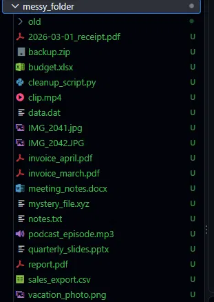
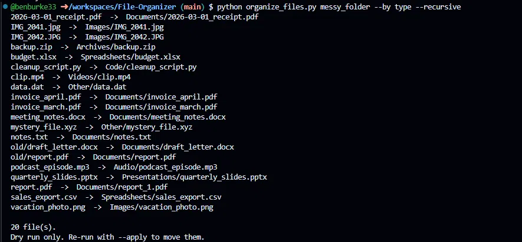
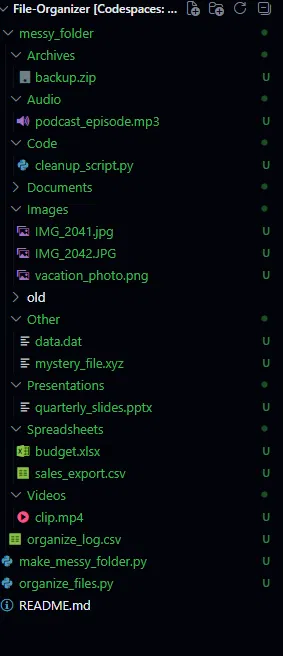

# File Organizer

Sort a messy folder of files into tidy subfolders by type or by date, with a safe preview mode and a one-command undo.

## The problem

Downloads folders, scanned invoices, and photo dumps pile up fast. Sorting them by hand is tedious, and most automatic tools move files with no way back. This script previews every change first, never overwrites anything, and logs every move so it can be reversed.

## Before / after

```
Before                          After (--by type)
Downloads/                      Downloads/
  invoice_march.pdf               Documents/invoice_march.pdf
  IMG_2041.jpg                    Images/IMG_2041.jpg
  budget.xlsx                     Spreadsheets/budget.xlsx
  backup.zip                      Archives/backup.zip
  notes.txt                       Documents/notes.txt
```





## Features

- **Dry run by default.** Nothing moves until you add `--apply`.
- **Sort by type** (Images, Videos, Audio, Documents, Spreadsheets, Presentations, Archives, Code, Other) or **by date** using each file's modified date.
- **Custom date folders** with `--format`, for example `%Y/%m` for `2026/11`.
- **Optional renaming** with `--rename`, which prefixes files with their date (`2026-11-09_name.ext`).
- **Recursive mode** to include files in subfolders.
- **Never overwrites.** Name collisions get a numeric suffix (`report_1.pdf`).
- **Undo.** Every applied run writes `organize_log.csv`, which can reverse the run.
- Hidden files are ignored.

## Installation

Requires Python 3.8+. No third-party packages needed.

## Usage

```bash
# Preview only (nothing is moved)
python organize_files.py ~/Downloads --by type

# Sort scans into month folders and actually move them
python organize_files.py ~/Scans --by date --apply

# Year/month folders, with dates added to filenames
python organize_files.py ~/Photos --by date --format "%Y/%m" --rename --apply

# Include subfolders
python organize_files.py ~/Invoices --by type --recursive --apply

# Reverse a previous run (preview first, then add --apply)
python organize_files.py ~/Scans --undo ~/Scans/organize_log.csv
python organize_files.py ~/Scans --undo ~/Scans/organize_log.csv --apply
```

## Notes and limitations

- Always run the preview first and check the list before using `--apply`.
- The undo log is overwritten by each new applied run, so undo a run before starting another if you might want to reverse it.
- Files with unrecognized extensions go into `Other/`.

## License

MIT